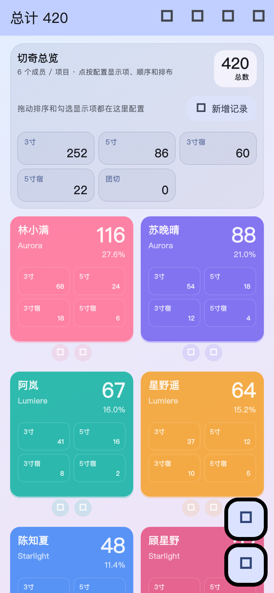
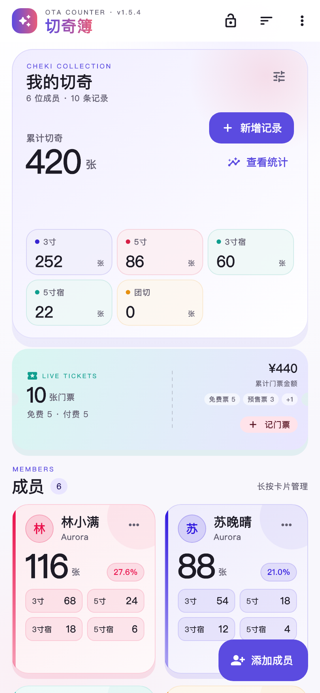
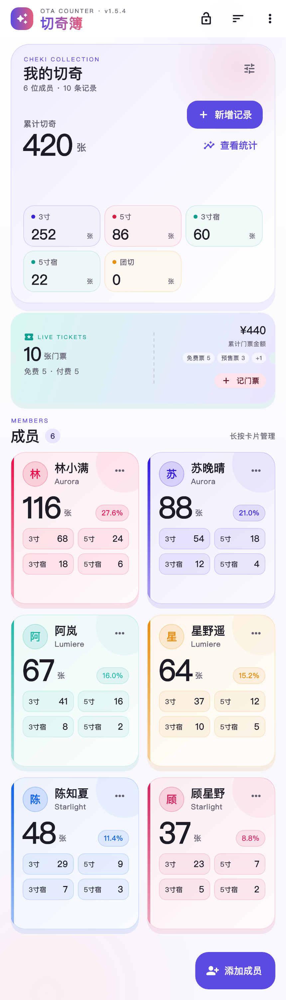
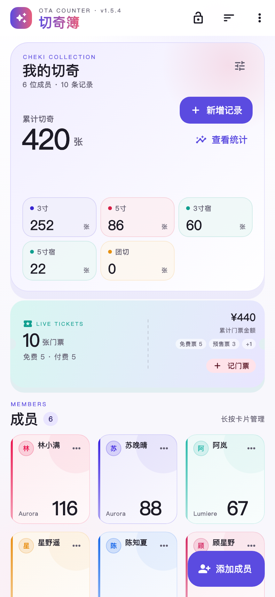
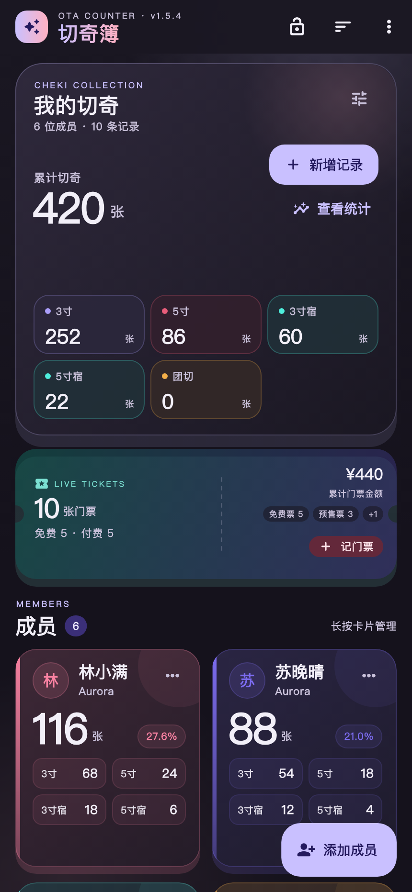
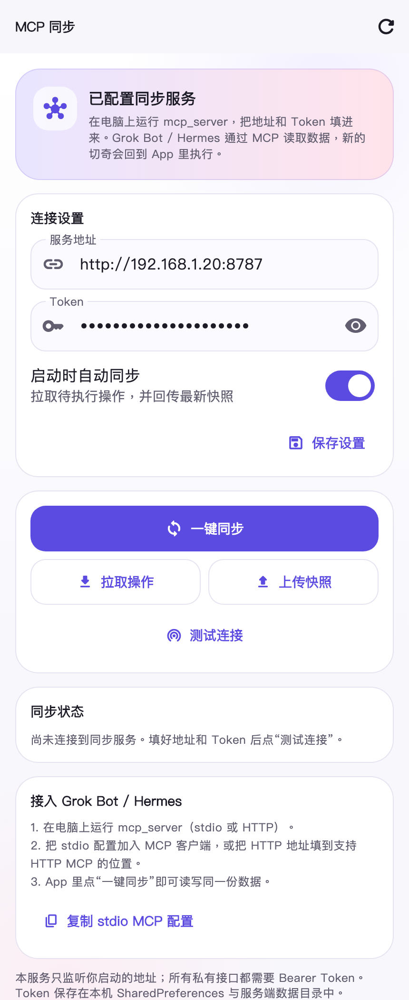
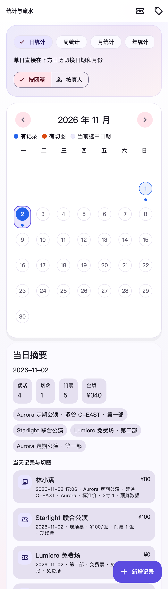
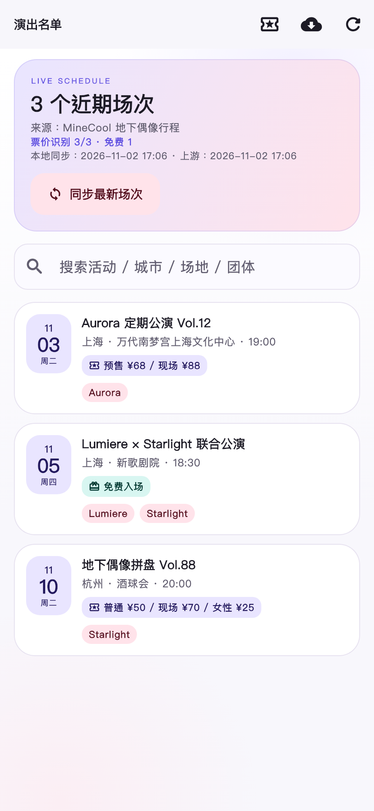
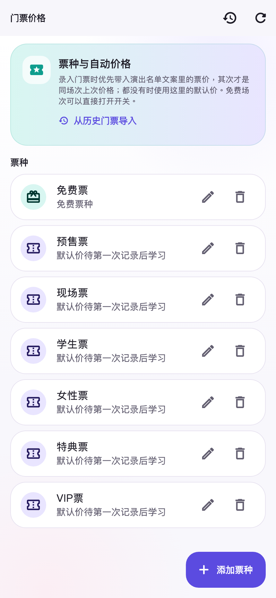
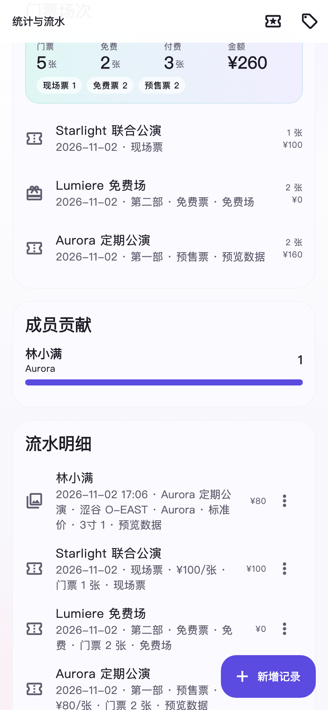

# OTA Counter UI Review — 2026-10-31

## 怎么看

截图使用 App 的真实 Flutter widget + 真实主题渲染，数据是本地 seeded demo
（6 位成员 / 10 条记录），不是设计稿。对比图：

| Before | After（浅色） |
| --- | --- |
|  |  |

| After（完整列表） | After（3 列） |
| --- | --- |
|  |  |

| After（深色） | 同步设置页 |
| --- | --- |
|  |  |

统计页（同步了新的页面背景与主题）：

> 生成命令：
> `python3 tool/ui_preview/prepare_font.py && flutter test tool/ui_preview/ui_preview_test.dart --update-goldens`
> 预览字体会在本地从系统 PingFang 生成，已被 `.gitignore` 忽略，不会进入 APK。

## 第二轮调整（2026-11-01）

针对“OTA Counter / 切奇总览这两个标太丑”：

- 顶部品牌改为 **切奇簿**，上面一行小字 `OTA COUNTER · v1.5.4`（字距拉开）。
- 总览标题改为 **我的切奇**，上面一行 `CHEKI COLLECTION`；去掉总览卡里重复的
  sparkles 图标和多余的“总数”徽章。
- 新增演出名单页：查看/同步 MineCool 缓存场次。

更新后的首页：

## 第三轮调整（2026-11-02）

- 首页不再只是“总览 + 卡片”：新增**带缺口/虚线的 LIVE TICKETS 票根卡**，把免费/付费、
  票种、门票金额放到首页；点“记门票”直接进入门票录入。
- 品牌字标改为紫→粉渐变；成员卡增加柔和色块/渐变底，减少“白板卡片”感。
- 新增 **门票价格** 页（票种、默认价、免费票、场次价格记忆），从演出名单/统计页进入。
- 统计页增加免费/付费/门票金额/票种明细；门票场次行显示票种和免费/付费。
- 演出名单卡片直接显示从 MineCool 文案解析出的“免费入场 / 预售 ¥68 / 现场 ¥88”，
  顶部还显示“票价识别 x/y”方便核对；录入门票选中该场次时票种和单价会自动带入。
- 门票价格页支持“从历史门票导入价格”，把老记录的票种/场次价格补回记忆。
- 首页/统计页滚动时顶部 AppBar 增加半透明遮罩，避免标题和内容叠在一起。

## 请重点 check 的点

1. **首页信息层级**：总计 → 分类型指标 → 成员卡片，是否一眼能看懂。
2. **成员卡片**：浅色底 + 左侧色条 + 头像首字是否符合你的审美；2 列密度是否合适。
3. **3 列模式**：名字是否还清楚，是否应该隐藏头像/缩小字号。
4. **操作入口**：编辑/删除从卡片底部移到了卡片右上角 `⋯` 和长按；锁定从 FAB
   移到了右上角。是否更清爽，还是更难点？
5. **FAB**：现在是“添加成员”，首页大按钮是“新增记录”；两个入口是否清楚。
6. **深色模式**：成员色是否仍然可读；概览卡渐变是否过亮。
7. **同步页**：字段、按钮顺序、状态卡是否清楚；是否要把“上传快照/拉取操作”
   收进二级菜单。
8. **统计页**：只换了背景/主题和饼图色板，布局未大改；是否需要下一轮重做。
9. **新字标**：“切奇簿 / 我的切奇 / CHEKI COLLECTION”这个方向是否对；要不要保留
   OTA Counter 英文作为主标。
10. **演出名单页**：入口在首页 `⋮` → 演出名单，或偶像数据库右上角的日历图标；同步/搜索/日期卡是否清楚。
11. **票根卡**：LIVE TICKETS 的缺口/虚线/免费付费/票种是否好看；按钮是否太挤。
12. **门票价格页**：票种列表、默认价、免费开关、场次价格记忆是否够用。
13. **门票录入**：票种下拉、免费开关、自动带入价格是否清楚；是否还需要“自定义票种”入口。
14. **演出名单票价**：从文案抓取的“预售/现场/免费”是否准确；有没有误把抽奖/积分当成票价。

## 本次视觉/交互改动

- 新增 `lib/theme/app_theme.dart`：Material 3 设计令牌、浅/深色主题、按钮/输入框/
  弹窗/卡片/菜单/FAB/空状态等统一风格。
- 新增 `lib/widgets/app_page_background.dart`：静态径向渐变 aurora 背景，不使用
  BackdropFilter，避免滚动时重复模糊。
- 首页：
  - 透明 AppBar + 版本信息 + 锁定/排序/更多菜单。
  - 总览卡重做：大数字、成员/记录数、指标卡（带色点/单位/可配置）。
  - 成员区增加标题、计数、长按提示。
  - 加载骨架屏、空状态、下拉刷新。
  - 单个“添加成员”FAB，锁定移入 AppBar。
- 成员卡片：
  - 不再整卡高饱和填色，改为“成员色 8% 洗色 + 色条 + 首字头像”。
  - 大数字、百分比 pill、分类计数 chip，深色下自动提亮强调色。
  - 卡片右上角 `⋯` 菜单（编辑/更多操作/删除），长按仍可打开管理面板。
- 统计页：AppPageBackground + 统一饼图色板 + 透明 AppBar。
- MCP 同步页：连接设置、自动同步、一键同步、拉取/上传、状态、MCP 配置复制。
- 演出名单页：`LIVE SCHEDULE` 概览、来源/同步时间、搜索、日期卡、远程同步。
- 同步服务新增 Docker / systemd / Nginx 生产部署（见 mcp_server/DEPLOY.md）。

## 已知取舍

- 卡片编辑/删除从“一眼可见”变成“多一次点击”，换取更干净的阅读界面。
- 3 列/4 列/5 列仍是“姓名 + 总数”的紧凑模式；小屏 5 列可能只适合快速扫数。
- 预览截图里的 Material elevation 阴影由 Flutter test renderer 绘制，和真机略有
  差异；真实 App 的阴影更柔和。
- 字体预览使用系统 PingFang 子集，仅用于截图；App 仍使用平台默认中文字体。

## 设计参考（GitHub 开源）

这一轮没有引入新的 UI 依赖，主要借鉴了下面这些开源项目的排版/层次/卡片语言：

- [arun2github/aesthetic-flutter-ui](https://github.com/arun2github/aesthetic-flutter-ui)
  — 低饱和渐变、圆角卡片、指标块的层次。
- [sunarya-thito/shadcn_flutter](https://github.com/sunarya-thito/shadcn_flutter)
  — 统一 design token、输入框/菜单/弹层的细节。
- [aljalo/responsive_dashboard](https://github.com/aljalo/responsive_dashboard)
  — 响应式 dashboard 的留白和网格密度。

主题和组件仍是项目自己的 Material 3 实现，没有绑定第三方 UI 包，避免增加
APK 体积和维护成本。
